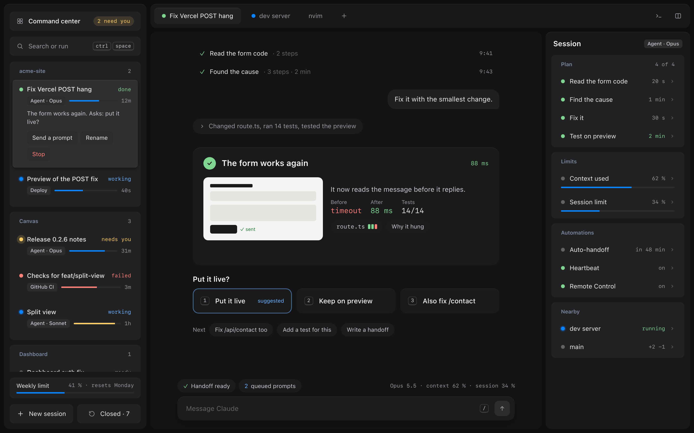
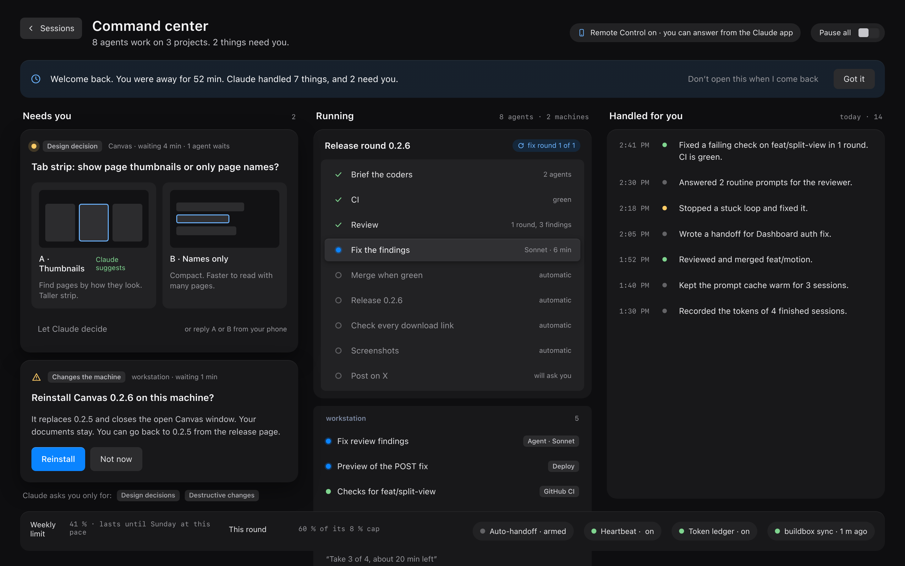
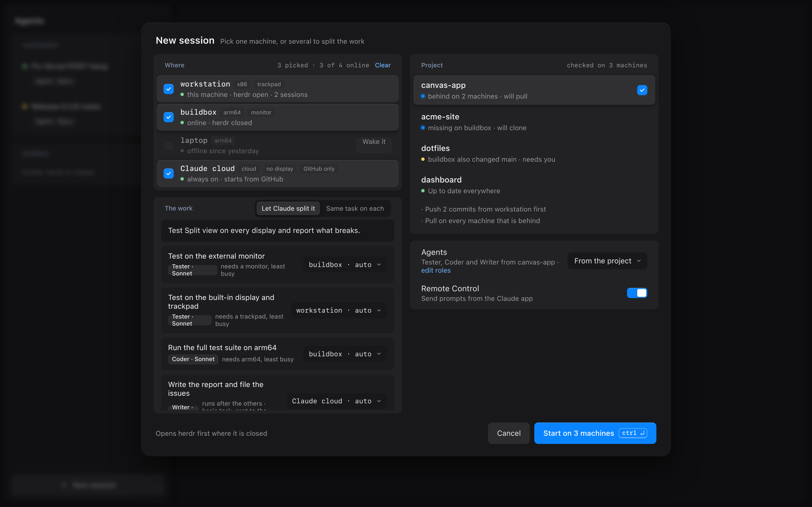
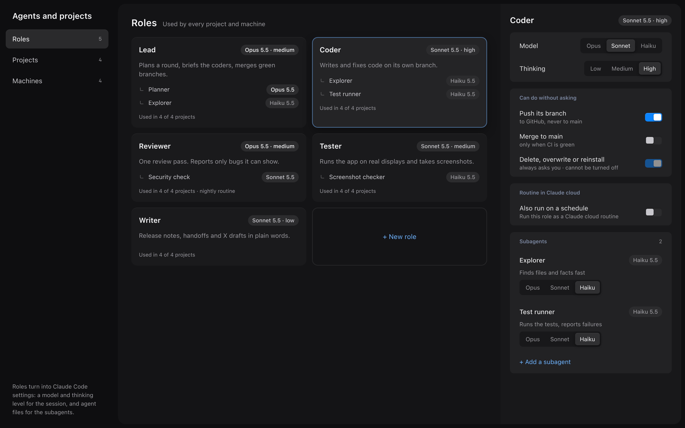
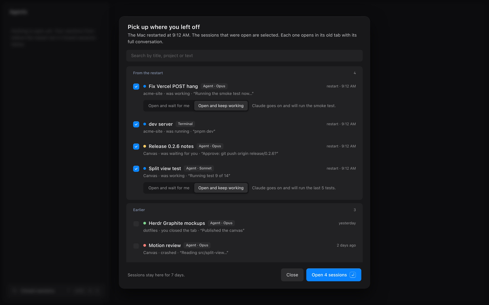
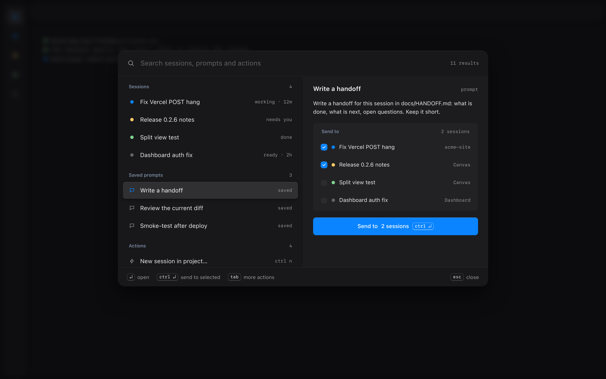
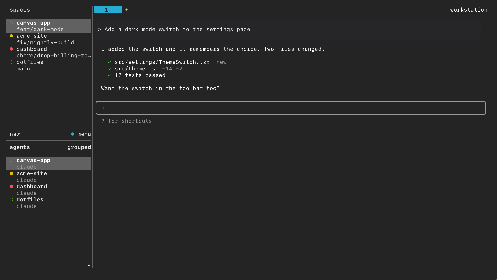
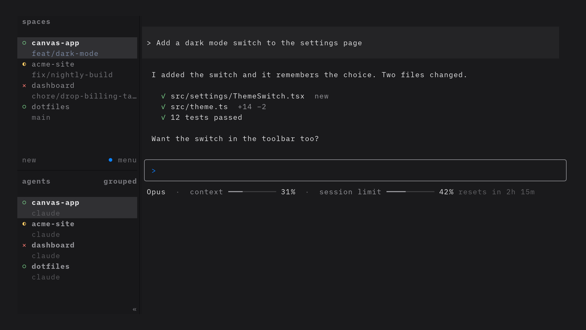

# herdr-graphite

A calmer, more graphical way to run many Claude Code agents in [herdr](https://herdr.dev), the terminal workspace manager for coding agents. It uses the Graphite theme for [Omarchy](https://omarchy.org).

**Status: a concept, with two build steps done (H1 base setup, H2 data feed).** This repo holds a design brief, clickable mockups, a probe mod and the base setup configs. The Graphite app is not built yet. See [docs/build-plan.md](docs/build-plan.md).

## Video

A 72-second walkthrough of the clickable mockups, with made-up data: [docs/video/herdr-graphite-concept.mp4](docs/video/herdr-graphite-concept.mp4).

## Screenshots

Rendered from the mockups with made-up data.

| | |
|---|---|
|  **I · Session view** |  **D · Command center** |
|  **J · Start on several machines** |  **K · Agents and projects** |
|  **F · Pick up after a restart** |  **B · Command bar** |

## Base setup

H1 is the first build step. It changes how herdr, the terminal and Claude Code look. It needs no new app.

**What it changes**

- **herdr:** Graphite colours, no tab bar while a workspace has one tab, and distinct symbols for agent states. Your keys stay.
- **Ghostty** (replaces foot): roomy padding, the iA Writer Mono S font and Graphite colours. See [config/ghostty/](config/ghostty/README.md).
- **Claude Code:** a Graphite theme, and a status line with the model, a context bar and a bar for the 5-hour session limit. It shows no dollar costs.

| Before (foot) | After (Ghostty) |
|---|---|
|  |  |

The session in these pictures is staged, with made-up data. `scripts/render-base-shots.sh` draws it in a headless Weston, so nothing opens on your desktop.

**Install**

```
scripts/install.sh --dry-run        # shows the plan, changes nothing
scripts/install.sh --with-ghostty   # installs Ghostty (sudo -n pacman), then applies the configs
herdr server reload-config          # applies the herdr config to the running server
```

The script copies each file that it replaces to `<file>.bak.graphite-<time>`. It edits only `theme` and `statusLine` in `~/.claude/settings.json`. To open herdr in Ghostty, see [config/ghostty/](config/ghostty/README.md). To test without touching your real files, run it with a temporary home: `HOME=$(mktemp -d) scripts/install.sh`.

**Undo**

```
scripts/uninstall.sh
```

This puts the backups back and sets the theme and the status line to their earlier values. It undoes only the newest install. After two installs, run it twice. The Ghostty package stays installed.

**Tests:** `scripts/test-statusline.sh` runs the status line with sample input. `scripts/test-install.sh` runs install and uninstall in a temporary home, with a fake terminal command, so nothing real changes.

## Data feed

H2 adds a small Claude Code plugin, `graphite` (in [mods/graphite/](mods/graphite/)). It tells herdr what each session does, so the Graphite app can draw the session cards. It also adds the Brief reply rule.

**What it sends.** Each hook runs `herdr pane report-metadata` in the background. A hook returns in about 10 to 45 ms and never waits for herdr. git and hostname have a 150 ms limit; on a timeout the last value stays. Outside herdr the feed does nothing. The Brief rule works in every session.

| Field (token) | Content |
|---|---|
| `--title` | The first prompt, short. The agent's own task name replaces it when the session has one. |
| `state` | `ready`, `working`, `needs`, `done` or `failed` |
| `machine`, `project`, `branch` | The host name, the git repository folder (also in a worktree) and the branch |
| `model`, `mode` | "Opus 5.5"; the reply style: `brief`, `normal` or `full` |
| `step`, `steps` | The step that runs now; one letter per plan step: `d` done, `n` now, `p` pending |
| `context`, `limit`, `limit_reset`, `weekly` | Context use %, 5-hour session limit %, when it resets (epoch seconds), weekly limit %. The limits exist only on a Claude subscription. The weekly reset time (`weekly_reset`) is in the feed file only. |
| `last` | The first line of the last message (the result line) |
| `ask` | What the agent waits for, while `state` is `needs` |
| `started`, `since` | Epoch seconds: session start and last state change ("waiting 4 min" is now minus `since`) |

The state labels are also set, so the herdr sidebar shows them: `working` is the current step or tool ("Editing feed.ts"), `blocked` is the question, `done` is "Done", and `idle` is "Ready", "Idle" or "Failed". herdr keeps its own live `agent_status`. Use it for the exact moment of a change, and use these fields for the facts.

The plan comes from TodoWrite, or from TaskCreate and TaskUpdate. After `/clear`, the title, the plan and the last line start over. The plugin also writes the whole snapshot, with all plan steps, step times and the ask, to `~/.local/state/herdr-graphite/feed/<pane>.json` for the app. If herdr refuses a report, its answer is in the `.err` file beside it.

**Reply style (Brief).** The plugin adds a rule to the system prompt for chat replies: the result in the first line, at most 3 lines of prose, then structured blocks (`Files:` and `Tests:` lines in a fixed form). The rule says that files, documents, reports, briefs, handoffs, commit messages and pull request text are written in full, that a request for a full report comes first, and that no reply ends with an offer to say more (a session on its own has nobody to answer). Teammate, print (`-p`) and analysis prompts get no rule, and a subagent's prompt is built without it (checked in the end-to-end test). `/brief`, `/normal` and `/full` change the style for one session. The next prompt carries a note about the change, so the system prompt (and the prompt cache) stays as it is. The default style is the `defaultMode` option of the plugin.

**Install.** The plugin loads in the next Claude Code session. It changes your user settings (`enabledPlugins`, `extraKnownMarketplaces`) and nothing else.

```
claude plugin marketplace add /path/to/herdr-graphite
claude plugin install graphite@herdr-graphite --scope user
```

**Turn off.** `claude plugin disable graphite@herdr-graphite` stops the feed and the Brief rule. `claude plugin enable graphite@herdr-graphite` starts them again. The feed has no switch of its own: it stops only when the plugin is off. For one session, `/normal` turns off the Brief rule only, not the feed.

**Undo.**

```
claude plugin uninstall graphite@herdr-graphite
claude plugin marketplace remove herdr-graphite
```

herdr drops the fields when the session ends (the plugin clears them), or when the pane closes.

**Try it without installing.** `claude --plugin-dir mods/graphite` loads the plugin for one session only.

**Tests.** `scripts/test-mods.sh` runs `claude plugin validate`, `claude plugin test` (sample JSON for each hook) and `scripts/test-feed.sh`. The last one runs the real Claude Code inside a throwaway herdr, with a temporary config and a fake API, and checks what `herdr pane get` shows. A sample run: [docs/test-logs/H2-feed.log](docs/test-logs/H2-feed.log).

## The idea

herdr is a strong engine, but its interface is a terminal: monospace text, hard lines, and walls of output. herdr-graphite keeps herdr as the engine and adds:

- **A command center for autonomous builds.** You see what goes on. Agents ask you only for design decisions and for changes that delete, overwrite or reinstall something. The basic work is done and logged.
- **A Graphite chrome.** A sidebar with session cards, tabs, a Session rail and a command bar. Every item opens with details and actions.
- **Calmer agent chat.** Short replies plus cards (result, plan, compare, screenshots), with the details folded until you open them.
- **Many machines.** Start agents on any online machine, or on Claude cloud for basic tasks. herdr syncs the git repos and splits the work by what each machine can do.
- **Roles.** Global agent roles with a model, a thinking level, permissions and subagents. Each project assigns roles to task types.
- **Pick up after a restart.** One Closed sessions menu reopens your sessions with their full conversations.

## What is here

| Folder | Content |
|---|---|
| [docs/design-brief.md](docs/design-brief.md) | Goals, decisions and the rules the design follows |
| [docs/build-plan.md](docs/build-plan.md) | Phases, estimates and how each phase is checked |
| [mockups/](mockups/) | The interactive mockups (artboards A–K), with made-up data |
| [mods/genui-probe/](mods/genui-probe/) | A small Claude Code mod that tests what a mod can draw in a terminal |
| [mods/graphite/](mods/graphite/) | The Claude Code plugin: data feed to herdr and the Brief reply rule |
| [config/](config/) | herdr, Ghostty and Claude Code configs for the base setup |
| [scripts/install.sh](scripts/install.sh) | Applies the base setup. `uninstall.sh` undoes it. |
| [scripts/privacy-scan.sh](scripts/privacy-scan.sh) | Checks the repo for private data before a push |
| [scripts/render-mockups.sh](scripts/render-mockups.sh) | Renders the mockups to PNG with headless Chromium |
| [scripts/test-mods.sh](scripts/test-mods.sh) | Tests the plugin (unit tests and an end-to-end run in a throwaway herdr) |
| [scripts/render-base-shots.sh](scripts/render-base-shots.sh) | Renders the base setup before and after pictures in headless Weston |

The mockups are `.dc.html` files made on a claude.ai Design canvas. They need that canvas to render. [mockups/README.md](mockups/README.md) describes each one.

## Privacy

All names in this repo are examples: the machines (`workstation`, `buildbox`, `laptop`) and the projects (`canvas-app`, `acme-site`, `dashboard`, `dotfiles`). Run `scripts/privacy-scan.sh` before every push. It reads your own private words from a file outside the repo.

## License

[MIT](LICENSE)
